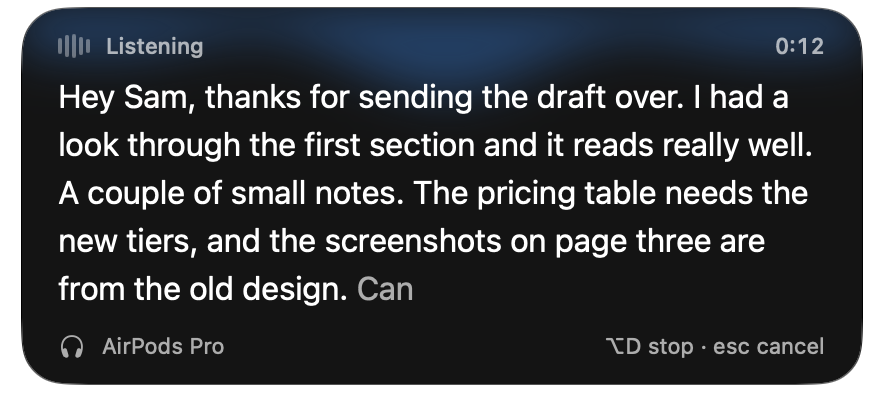
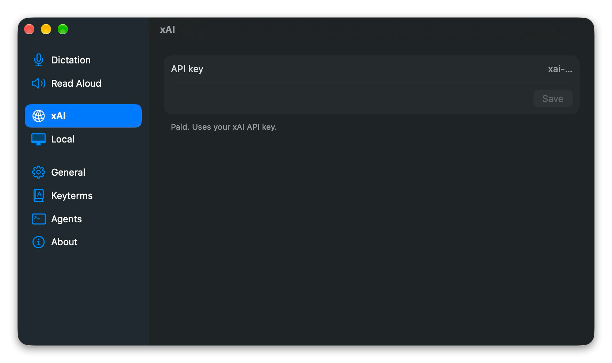
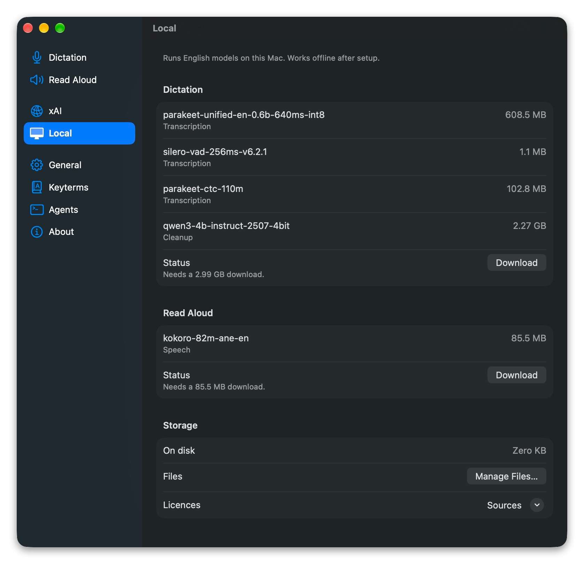
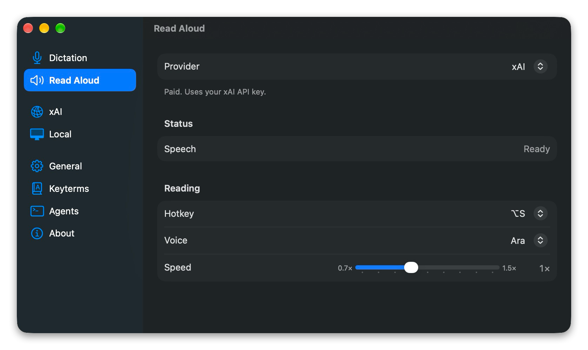

<p align="center">
  
</p>

<h1 align="center">EchoType</h1>

<p align="center">
  Dictation and read aloud for macOS, using xAI or local models.
</p>

<p align="center">
  <a href="https://github.com/AidanZealley/echotype/releases/latest">Download the latest release</a>
</p>

EchoType lives in the menu bar. Press <kbd>⌥</kbd><kbd>D</kbd> in any app and start
talking. Your words appear in a small overlay as you speak. Press the hotkey again
to paste the transcript where your cursor was. Select text and press
<kbd>⌥</kbd><kbd>S</kbd> to hear it read aloud.

<p align="center">
  
</p>

## Download and install

EchoType requires macOS 26 or later. Local models also require an Apple silicon Mac
and several gigabytes of free space.

1. Download `EchoType-<version>.dmg` from the
   [latest release](https://github.com/AidanZealley/echotype/releases/latest).
2. Open the DMG and drag EchoType into **Applications**.
3. Launch EchoType. The app is not notarized yet. If macOS blocks it, open
   **System Settings → Privacy & Security** and choose **Open Anyway**.
4. Allow **Device Control and Data Access** when prompted. EchoType uses this
   permission for global hotkeys and inserting text.
5. Open **Settings…** from EchoType's waveform icon in the menu bar and set up a
   provider below.

macOS asks for microphone access when you first dictate. To update, quit EchoType
and replace it in Applications with the app from the latest DMG. You can also find
the release link in **Settings → About**.

## Choose a provider

Choose providers separately on the **Dictation** and **Read Aloud** settings pages.
You can use xAI for one and Local for the other.

### xAI

xAI uses its online API for transcription, text cleanup and speech. It requires an
internet connection and your own API key. API usage is paid through your xAI account.

1. Create an API key in the [xAI console](https://console.x.ai).
2. Open **Settings → xAI**, paste the key and click **Save**. EchoType stores it in
   your Mac's Keychain.
3. Choose **xAI** on the **Dictation** and **Read Aloud** pages for the features you
   want to use.

<p align="center">
  
</p>

### Local models

Local runs English transcription, text cleanup and speech on your Mac. It needs no
API key and works offline after setup. EchoType uses Parakeet for transcription,
Qwen for cleanup and Kokoro for read aloud.

1. Open **Settings → Local**.
2. Click **Download** for **Dictation**, **Read Aloud**, or both. Wait for the models
   to download and prepare.
3. Choose **Local** on the corresponding **Dictation** or **Read Aloud** page.

Selecting Local alone does not download models. The first model load can take tens
of seconds.

<p align="center">
  
</p>

Downloaded models stay on your Mac when you switch providers. Use
**Settings → Local → Manage Files…** to remove them, including before uninstalling
EchoType. Moving the app to Trash leaves the models behind. See the
[local storage guide](docs/local-models.md) for details.

## Using EchoType

- Press <kbd>⌥</kbd><kbd>D</kbd> to start, then press it again to insert
  the text. Press <kbd>Esc</kbd> to discard it. Cleanup joins sentences split by pauses
  and removes phrases you take back.
- Select text and press <kbd>⌥</kbd><kbd>S</kbd>. Press
  <kbd>Space</kbd> to pause. Choose a voice and speed in **Settings → Read Aloud**.
- Save names and jargon in **Settings → Keyterms** to help
  dictation spell them correctly. Both providers support up to 100 saved terms.
- Open **Last Dictation…** from the menu bar to inspect
  cleanup and copy the details as JSON.

<p align="center">
  
</p>

If another app uses the default hotkeys, choose the <kbd>⌃</kbd><kbd>⌥</kbd>
alternatives in Settings. **Settings → General** also has launch-at-login and
permission controls. You can disable hotkeys from the menu bar.

### Voice replies from agents

EchoType includes an MCP server so agents can read their answers aloud. Open
**Settings → Agents**, copy the command for Claude Code or Codex, run it in a
terminal, then start a new agent session. Keep EchoType running.

End a dictation with "reply with EchoType" to send it automatically when
**Send reply requests** is enabled. The agent can call EchoType's `speak` tool to
read a short summary, then write its full answer. The Agents page has optional
instructions to copy into your agent's instruction file.

## Development

You need macOS 26 or later and Xcode 27. Running EchoType also needs an Apple
Development signing certificate in your Keychain. A signed app bundle lets macOS
keep microphone and accessibility permissions between builds.

Install Xcode's Metal Toolchain once for the local cleanup runtime:

```sh
xcodebuild -downloadComponent MetalToolchain
```

```sh
./scripts/run.sh              # build, sign and launch .build/EchoType.app
./scripts/run.sh --hud-demo   # preview the overlay without a microphone or API key
XAI_API_KEY= ECHOTYPE_FIXTURE_WAV= swift test
./scripts/install.sh          # build a release and replace /Applications/EchoType.app
```

`run.sh` and `install.sh` quit running copies of EchoType before launching the new
build. If you have multiple signing certificates, set `ECHOTYPE_SIGNING_IDENTITY`.
Use `security find-identity -v -p codesigning` to list them.

Tests and `swift build -c release --product EchoTypeApp` need no signing certificate.
Integration tests call xAI only when `XAI_API_KEY` is set. The live protocol test
also needs `ECHOTYPE_FIXTURE_WAV` pointing to a recording.

`EchoTypeCore` contains session, provider and settings logic. `EchoTypeApp` contains
the AppKit and SwiftUI app. For more detail:

- [Architecture decisions](docs/decisions/README.md)
- [Provider adapter contracts](docs/decisions/0025-provider-adapters.md)
- [Local models and runtime policy](docs/decisions/0026-local-model-stack.md)
- [Local model storage](docs/local-models.md)
- [Packaging and releasing a DMG](docs/releasing.md)
